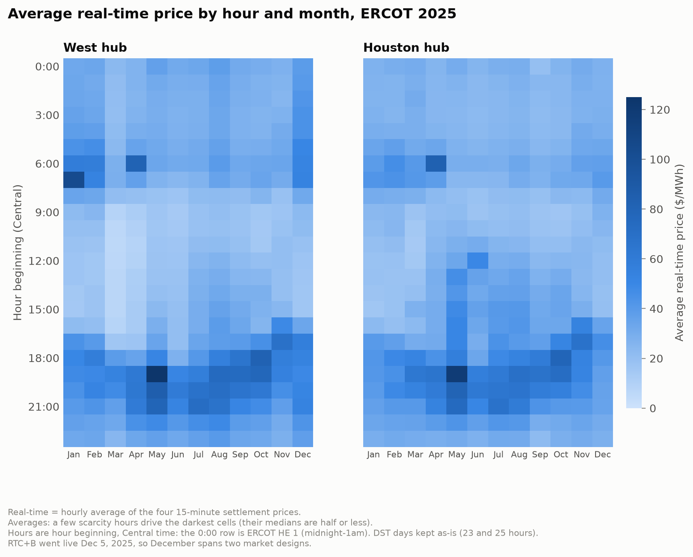
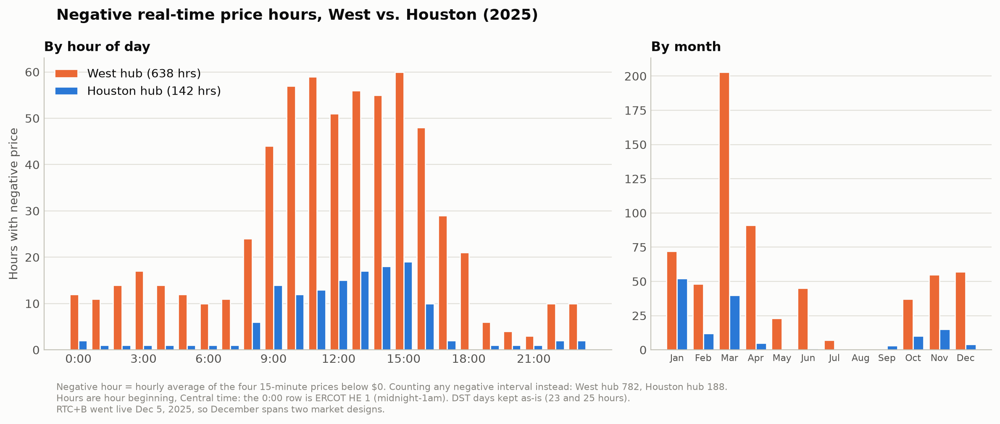
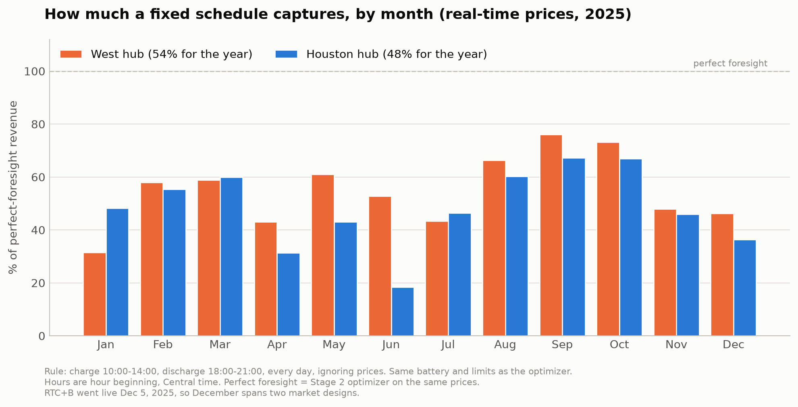
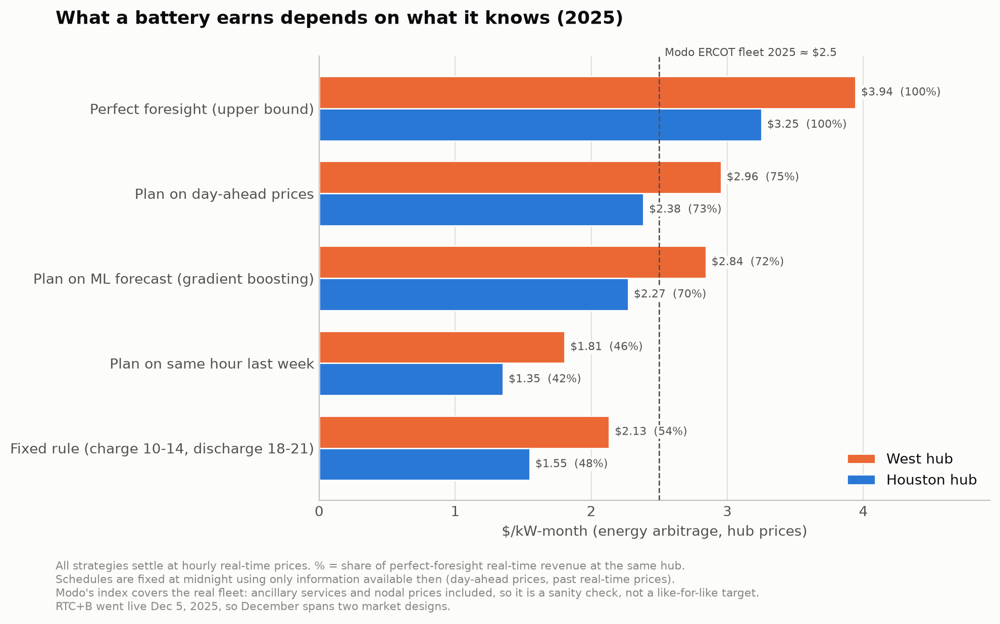

# ERCOT Battery Dispatch Model

## The question

If you owned a battery in Texas in 2025, how much money could it have made?
And how close do realistic strategies get to the best possible result?

The battery: 100 MW / 200 MWh, 85% round-trip efficiency, at most one cycle a day.
Prices: ERCOT 2025 hourly day-ahead and real-time prices at two hubs, **HB_WEST** (wind and solar heavy) and **HB_HOUSTON** (load heavy).

## The 5 strategies

All five are scored the same way: paid hourly real-time prices.

1. **Perfect foresight.** A linear program that knows every price in advance. This is the upper bound, not something anyone can actually earn.
2. **Plan on day-ahead prices.** Use tomorrow's day-ahead prices (published the day before) as the forecast, optimize, then get paid real-time.
3. **Plan on an ML forecast.** Gradient boosting trained on past prices (including day-ahead), refit each month on data before that month only.
4. **Plan on same hour last week.** Use the real-time price from 7 days earlier as the forecast.
5. **Fixed rule.** Charge 10am–2pm, discharge 6–9pm, every day, ignoring prices.

## Findings

1. **Negative prices come at midday now, not at night.** West had 638 negative real-time hours in 2025, mostly between 9am and 4pm. That likely points to solar, not wind.
2. **The best possible revenue was $4.7M at West and $3.9M at Houston.** West's cheaper midday power makes for wider spreads.
3. **The fixed rule captures about half of the best possible.** Its timing is fine: the best fixed window, picked with hindsight, only does 2–5 points better. What it lacks is flexibility. It misses morning price spikes like January 15 and April 7.
4. **The day-ahead price is the forecast to beat, and ML didn't beat it.** With day-ahead as an input, the ML model was statistically tied at West and about 3 points worse at Houston. Day-ahead also had the lowest forecast error, so here lower error did mean more money.
5. **The realistic numbers look right.** The realistic strategies land at $2.27–$2.96/kW-month. Modo Energy estimated about $2.50/kW-month (~$30/kW-yr) for the real ERCOT fleet in 2025.

## Charts

**when power is cheap and expensive**


**negative-price hours, west vs. houston**


**how much the fixed rule captures, by month**


**what a battery earns depends on what it knows**


## Caveats

- **energy arbitrage only.** no ancillary services.
- **hub prices, not node prices.** a real battery settles at its own node
- **price taker.** the battery doesn't move prices.
- **hourly real-time prices**, not the actual 15-minute settlement. this smooths out spikes inside the hour.
- **each day starts and ends empty**, so no carrying energy overnight.
- **schedules are fixed at midnight.** real operators re-plan during the day.
- **no degradation cost.** a $5–10/MWh cycling cost barely changes dispatch (under 0.5% of revenue).
- **RTC+B** december 2025, RTC+B went live december 5.

## Run it

```bash
python -m venv .venv && .venv/bin/pip install -e ".[dev]"
.venv/bin/python scripts/stage1_prices.py      # download prices, heatmaps
.venv/bin/python scripts/stage2_optimizer.py   # perfect foresight
.venv/bin/python scripts/stage3_rule.py        # fixed rule
.venv/bin/python scripts/stage4_forecasts.py   # forecasts (downloads 2024 for training)
.venv/bin/python -m pytest tests
```
